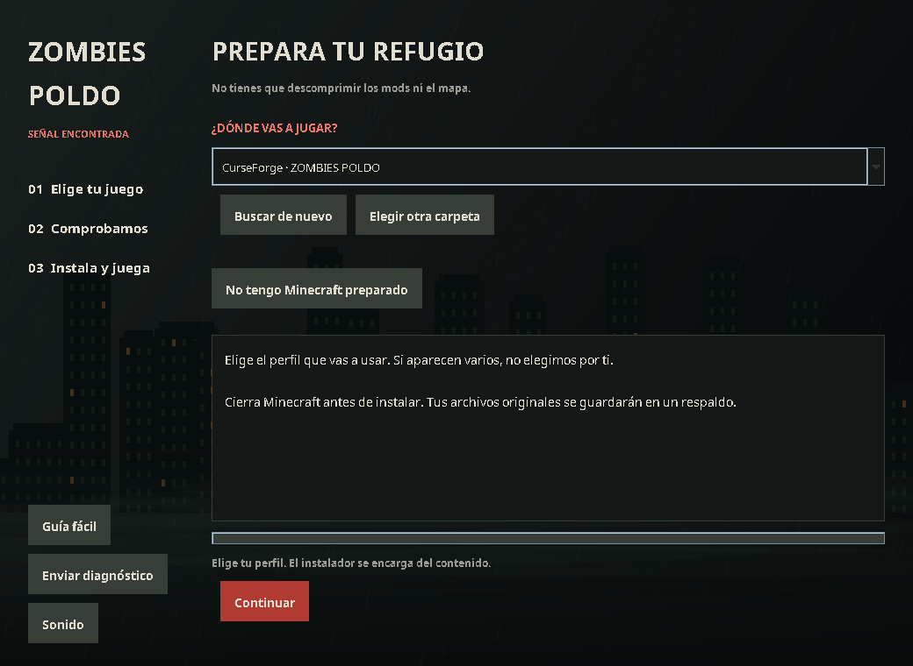

# Zombies Poldo — Instalador sencillo 1.3.0

[Descargar instalador](Zombies-Poldo-Instalador-Sencillo-1.3.0.zip) · [Fuentes y pruebas](Zombies-Poldo-1.3.0-Fuentes-y-pruebas.zip)

Extrae el ZIP y abre **Instalar.cmd**. Elige tu juego, pulsa **Continuar** y después **Instalar ahora**. El contenido interno está comprimido; el instalador se encarga de extraerlo.

Incluye detección de perfiles de CurseForge y TLauncher, opción para preparar un ZIP importable en CurseForge, descarga automática de Java 21 cuando falta, guía sencilla, registros de diagnóstico, respaldos y restauración. Conserva la estética y el sonido del instalador original.

**Esta descarga es la plantilla del instalador. El archivo original no incluía mods ni mapa.** El creador debe poner los ZIP/JAR del modpack en `Para-el-creador/componentes` y abrir `Preparar-distribucion.cmd`. El ZIP completo generado es el que se entrega a los jugadores; las herramientas del creador quedan fuera de esa distribución.

Pasaron 34 pruebas funcionales de detección, extracción, instalación, respaldo, restauración y empaquetado. Se comprobó la sintaxis de PowerShell. No se ejecutó el instalador en Windows, CurseForge ni Minecraft; la descarga de Java desde Adoptium tampoco pudo comprobarse desde esta nube (HTTP 403). Antes de distribuir un modpack, valida el ZIP completo en Windows y en una copia de una instancia con partidas.

[Informe de validación y SHA-256](VALIDACION-1.3.0.json)
